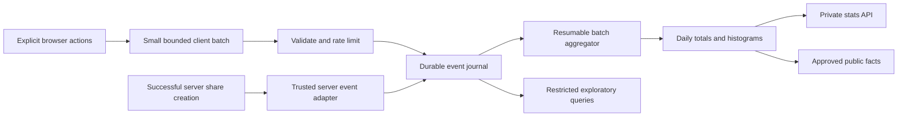

# Stats tracking: audit and architecture

Status: proposed; no tracking or production configuration changed.

Goal: trustworthy product metrics, scalable collection, and enough history to create interesting facts about simulator use without collecting full builds or raid logs.

## 1. Findings from the current implementation

The tracking files reviewed match `origin/main` at audit time. Related simulator integration was inspected on the current `dps-sim/v0` checkout. Existing unrelated changes are outside this plan.

| Finding | Evidence | Consequence | Priority |
| --- | --- | --- | --- |
| Class tracking uses only `body.header?.class` | `src/lib/load-character.ts` | Valid loadouts can fall into Other when header metadata is absent. | P0 |
| Missing and unrecognized classes share one bucket; original cause is discarded | `src/lib/server/stats.ts`, `commandsFor` | The five existing Other loads cannot be attributed retrospectively. | P0 |
| Successful pasted data bypasses tracking | `src/routes/+page.svelte`, `tryPaste` | Character loads and class/region totals omit this path. | P0 |
| File imports have no explicit import metric | `src/lib/import-simulation.ts` | Imported builds cannot be distinguished from other activity. Do not silently redefine these as remote character loads. | P1 |
| Client fetch ignores HTTP failures and has no retries | `src/lib/stats.ts` | Temporary failures silently lose events. | P0 |
| Storage errors are swallowed and ingestion still returns 204 | `src/lib/server/stats.ts`, `src/routes/api/count/+server.ts` | An accepted-looking response does not establish that anything was persisted. | P0 |
| Daily fields and distinct-character updates use a non-atomic Redis pipeline | `src/lib/server/stats.ts`, `src/lib/server/redis.ts` | A partial failure can leave inconsistent totals. Adding retries without idempotency would risk duplicates. | P0 |
| Simulator opens are deduplicated once per character per JS module lifetime | `src/lib/SimulatorPage.svelte`, `src/lib/stats.ts` | Returning within a tab may not count; reloading can count again. Snapshot switches are not independently measured. | P0 |
| Share opens are counted in the server page loader with a user-agent filter | `src/routes/s/[character]/[id]/+page.server.ts` | A server fetch is not proof of visible human viewing; prefetches/reloads and bot detection affect counts. | P0 |
| Named-save tracking fires after a new saved-plan ID is returned | `src/lib/upgrade-planner/SavedSimulations.svelte` | Reasonable existing behavior; preserve the distinction between new saves, duplicate saves, imports, and autosaves. | P1 |
| Shares await a stats write after their main operation | Share API and shared-page loader | Optional telemetry can add up to its configured timeout to sharing/opening. | P1 |
| Body size is checked after reading the complete body | `/api/count` | Oversized streamed input is not bounded during reading. | P1 |
| Origin validation exists, but no ingestion rate limit or duplicate protection exists | `/api/count` | Direct scripts can inflate counts; origin checks alone do not authenticate events. | P1 |
| Distinct characters use HyperLogLog | `src/lib/server/stats.ts` | Values are estimates; daily distinct counts cannot be summed into period distinct counts. They are not unique people. | P0 |
| Events contain no calculator version or consistency context | Current event schema | Changes in formulas or inconsistent snapshots cannot be isolated in future numeric facts. | P1 |
| Reporting reads every requested day's hash and HLL | `readStats` | Fine today; all-time reporting grows with site age and added dimensions. | P1 |
| The stats page has totals and daily tables, but no collection-health/coverage information | `/stats` | Missing data is visually indistinguishable from genuine inactivity. | P1 |

The existing Other count proves only that five successful load events lacked a recognized class. It does not prove which metadata field or spelling failed in those particular events.

## 2. Measurement rules

Maintain a small metric dictionary in code and documentation. Every metric must define its trigger, population, unit, deduplication, source, start date, and exclusions.

- **Traffic:** visitors, page views, referrers, devices, countries. Keep the existing hosting analytics responsible for this. Do not implement a second visitor fingerprinting system.
- **Product activity:** character loads, rendered simulator views, edits, recommendations applied, budgets viewed, named builds saved, imports, and shares. Our tracking owns these.
- **Simulator outcomes:** hypothetical CP gains, target item levels, and estimated budgets. These describe plans, never purchases, real upgrades, actual spending, or actual DPS improvements.
- **Data quality:** unknown classes, invalid/mismatched snapshot baselines, rejected events, storage failures, retry duplication, aggregation lag, and missing numeric inputs.

Do not calculate a conversion funnel by dividing today's saves by today's loads. Those are different populations and may belong to different visits or characters. A visit-level funnel needs correlated events with a documented common denominator.

## 3. Target architecture

Use a versioned, minimal event journal plus materialized daily summaries. Keep Redis for existing sharing and legacy stats; introduce an analytics store behind an adapter rather than make Redis an indefinite list of raw JSON events.

Recommended journal model: managed PostgreSQL, with a serverless-compatible connection pool. This is a proposed new dependency, not an assumption that it is already configured. Provider, cost, region, and limits must be checked before provisioning.

Start with direct batched inserts and a scheduled aggregator; a separate message broker is unnecessary initially. A persisted journal row is also recoverable aggregation work. If ingestion capacity later requires a durable queue, insert it behind the same adapter without changing browser events.

Avoid serverless fire-and-forget promises. A request either awaits a bounded durable write or uses an explicitly supported durable delivery mechanism. Product operations must still succeed if analytics fails; server-side lost-event risk is observed, not hidden behind a claim of guaranteed delivery.

### Storage responsibilities

| Data | Storage and lifetime | Purpose |
| --- | --- | --- |
| Legacy daily hashes and HLLs | Existing Redis; retain unchanged | Historical continuity |
| Versioned minimal events | Analytics journal, initially 90 days | New questions, debugging, rebuilding recent rollups |
| Ingestion receipts | Journal uniqueness initially; at least 7-day retry protection | Idempotent acceptance |
| Daily summaries and histograms | Analytics store; retain indefinitely | Fast reports and long-term facts |
| Short-lived rate-limit state | Redis with expiry | Bound write abuse |
| Failed-event diagnostics | Bounded infrastructure logs/metrics | Operational health; no raw event dumps |
| Approved public facts | Small cached document | Public reads never scan raw events |

The 90-day raw retention is a default proposal. It explicitly limits future questions: a dimension not preserved in a rollup cannot be reconstructed after its source events expire. Keep important joint distributions, such as class by upgrade category, deliberately rather than assume marginal totals can answer them later.

## 4. Event contract

Define one shared discriminated TypeScript union and runtime validator. Reject unknown event types, unsupported schema versions, unexpected properties, invalid enum values, oversized strings/arrays, non-finite numbers, and out-of-range values. Do not accept arbitrary analytics property dictionaries.

Common fields:

| Field | Rule |
| --- | --- |
| `schemaVersion` | Event contract version, initially 2 |
| `eventId` | Random ID created once per action; unchanged during retry |
| `event` | Fixed event enum |
| `occurredAt` | Validated client timestamp; never determines trusted ingestion time |
| `receivedAt` | Assigned by server |
| `release` | Deployment/application revision; client label is advisory unless verified |
| `calculatorVersion` | Version of CP/DPS/budget formulas for numeric metrics |
| `visitId` | Optional random in-memory tab-visit ID, no persistent browser identity |
| `viewId` / `workId` | Random simulator-view/working-plan correlation, without build names |
| `source` | Small enum: search, roster, refresh, direct link, paste, file import, shared link |
| `mode`, `role`, `region`, `classId` | Validated enums, included only for relevant event types |
| `baselineStatus` | Consistent, mismatched, or unknown; snapshot source stored separately |
| `origin` | Server-controlled distinction between client-reported and server-observed events |

No character names, guilds, named build titles, raw URLs, bearer tokens, full loadouts, raw prices/inventory, filenames, player logs, or unrestricted user text in the journal. Route names are enums rather than URLs containing character names.

Character distinctness is a separate aggregation concern. Normalize character identity and hash it on the server before updating sketches; discard the submitted raw name. Keep the legacy hash scheme only for legacy continuity. A new keyed identifier scheme must start a separately labeled series: sketches using different identifiers cannot be meaningfully unioned.

Client metadata remains client-reported, even when well validated. Signed-in ownership or game verification is not established by this endpoint.

### Class resolution

Resolve canonical internal IDs using `loadout.classId`, then the current/estimated loadout candidates, then a normalized header value. Support internal keys and recognized display names through one resolver used by ingestion and UI.

If unresolved, emit `unknown_class` with a bounded reason enum: `missing`, `unrecognized`, or `conflicting`. Count only canonical IDs in public class tables. Retain only a sanitized, bounded identifier for genuinely unrecognized upstream class IDs in restricted diagnostics, never arbitrary header text. Detect conflicting recognized fields instead of silently switching classes.

## 5. Events and exact triggers

| Event | Trigger and counting rule |
| --- | --- |
| `character_load_completed` | Successful remote load or successful paste accepted by the app. One action ID per attempt; source distinguishes them. Rejected or unloadable data does not count as completion. |
| `character_load_failed` | One failed attempt, with fixed failure category: network, timeout, upstream, decode, no loadout, local persistence. Avoid raw error text. |
| `simulation_imported` | Successfully persisted file import; separate from remote loads and ordinary named saves. |
| `simulator_viewed` | Valid simulator rendered and document visible. Once per view, across normal, imported, and shared builds. A snapshot selection within the view is separate. |
| `snapshot_selected` | User explicitly selects another baseline. Record snapshot kind and consistency, not its full contents. |
| `simulation_edited` | First successful user mutation per work context/category. Initialization, restored autosaves, hydration, derived recomputations, and undo do not create first-edit events. |
| `max_applied` | Explicit Max control produced a change. Scope: row, card, or all. No event for an already-maxed no-op. |
| `upgrade_applied` | A recommendation successfully changes state. Category, CP/DPS mode, sorting mode, and approximate gain range. Failed/no-op application excluded. |
| `upgrade_list_viewed` | User opens the full Next Upgrades view. Record sorting mode; do not count its hidden mounted instance. |
| `budget_viewed` | User visibly opens budget. Record first view of the settled plan summary per work context; repeated opens can be a separate interaction counter. |
| `price_added` | A valid previously unpriced category gets a persisted price. Category and source only; no exact quote or inventory. Editing an existing price is separate. |
| `build_saved` | A new named build is actually persisted. Duplicate save, autosave, rename, pin, and import excluded. |
| `build_restored` | User explicitly restores a named plan, not automatic working-copy restoration. |
| `share_created` | Server successfully creates a share. Server authority; separate from a Share button click. |
| `share_viewed` | Valid shared build visibly rendered in browser. Loader requests remain a separate operational metric. Human identity is not guaranteed. |
| `plan_summary` | Compact settled summary attached to a new save/share; budget-view summaries have their own population. No periodic or per-drag snapshots. |

Feature events deduplicate per view or work context according to the dictionary; transport deduplication by event ID is a separate guarantee. Two intentional applications are two actions even if their payload values happen to match. Desktop/mobile duplicate components must call a shared action boundary, not independent mount tracking.

CP and DPS events share the contract, but DPS instrumentation ships only when that feature ships. Log import events, if added, contain success/failure and bounded run-count ranges, not raid data or player identities.

## 6. Plan summaries and numerical correctness

Capture a compact summary using results the simulator already computed. Never invoke expensive CP, DPS, or honing calculations solely for analytics or from a drag handler.

- Start and target item level; start CP and CP change percentage.
- Set of changed categories, bounded by known simulator sections.
- Honing targets and gem-level targets as small enums/ranges where useful.
- Average estimated gold only, with `complete`, `partially_priced`, `unpriced`, or `unavailable` status and missing-price count range.
- Bound-inventory contribution as `none`, `some`, `all`, or `unknown`, rather than raw inventory.
- Snapshot consistency, over-willpower/invalid configuration status, and calculator version.
- Budget and CP values use bounded precision; no full equipment details are needed.

Numerical facts exclude mismatched baselines, invalid configurations, non-finite results, and unsupported calculator versions. Zero gold is not interchangeable with missing price. Partial budgets are never included in a fully priced budget median or labeled a complete cost.

Saved-plan budgets need an existing valid budget result. If saving does not currently calculate a budget, record it as unavailable; do not add a costly calculation or invent a cost. A later explicit budget view contributes to its own population, not a retroactive save claim.

Record individual observations within bounded ranges in the short-lived journal. Long-term histograms support approximate median/percentile ranges and cross-period merging. Do not average daily medians or calculate exact medians from bucket midpoints. Save/share/budget observations are separate populations and must not be added into a count of distinct plans without a specific plan deduplication rule.

## 7. Useful facts and their evidence

| Example presentation | Required evidence | Caveat attached in the metric definition |
| --- | --- | --- |
| Most explored upgrade this week | First category edit per work context | Explored in simulations, not upgraded in game |
| Players pressed Max N times | Successful explicit `max_applied` actions | Actions, not unique players; public wording should say "Max was applied N times" |
| Most common item-level goal | Valid saved-plan start/target distribution | Saved plans can include multiple plans for the same character |
| Typical dream-build cost | Complete budget distribution for one chosen population | Approximate median range; estimated average gold |
| Most chosen recommendation | Successful `upgrade_applied`, category and sorting mode | Applies within simulator, not purchases |
| Which classes plan the biggest CP gains? | Class by CP-gain histogram from valid saves | Sample size and repeated-plan bias shown |
| How many plans use bound materials? | Budget observations by bound-use category | Only budget views with computed inventory contribution |
| Most popular gem target | Valid saved-plan target levels or successful gem upgrade applications | Choose and label one population |
| Which features get used after opening the sim? | Correlated visible views and first-use events | Within a tab visit; no claim of person-level retention |

Start public facts only after collection has enough coverage. Use a proposed minimum of 20 qualifying observations per displayed cohort and show its sample size and time range. This is an editorial floor, not a statistical guarantee or anonymity guarantee. Prefer distributions and common goals to individual extreme builds or rankings of named characters.

No general statements about all Lost Ark players from a self-selected site sample. No "gold spent", "DPS gained in game", or "upgrades purchased" claims.

## 8. Reliability and abuse controls

- Batch small events in memory: flush after a short idle interval or a small event limit; do not run network requests for every slider tick.
- On document hiding/navigation, use a same-origin keepalive request within strict byte limits. Existing Origin checks must remain compatible with the chosen transport.
- Keep a bounded in-memory retry queue. Retry network errors, 429 with backoff, and temporary 5xx using the same event IDs; drop malformed permanent failures. No persistent browser tracking ID or unbounded offline backlog.
- Return accepted status only after durable acceptance. A duplicate event is successfully accepted without another increment. A transient persistence failure is retryable, not a false 204.
- Enforce streaming request-body limits, batch-size limits, enum cardinality, and bounded numeric fields before storage.
- Apply short-lived rate limits and per-event ceilings. Coarse network-derived limiter keys may exist only briefly and never become analytics identities. Origin validation is defense in depth, not bot proof.
- Separate development, preview, internal tests, and production ingestion. Do not contaminate production with load tests or browser automation.
- Exclude obvious bot requests from operational view metrics, but label visible browser views honestly rather than promise perfect human detection.
- Keep write deduplication atomic with durable acceptance. For a Redis-only interim implementation, use a transaction/script rather than a pipeline plus separate dedup key.
- Server share creation should carry an observation ID tied to the created record so observation retries do not create more shares. Never retry the product mutation just to repair telemetry.
- Duplicate suppression, report caching, and rate limits must work across concurrent serverless instances, not just an in-process Map.

## 9. Aggregation, queries, and scale

The first journal can be an ordinary table with a unique event ID and indexes on ingestion time and event type. Insert in bounded batches. Avoid indexing every property. Use typed columns for common dimensions and narrowly validated per-event properties.

The aggregator processes committed, unprocessed batches under a durable claim/processed marker and transaction. Do not use only a high-water sequence cursor: concurrent transactions can commit out of order. Rollup updates and processed marking succeed together, so a crash can retry without double counting. Add late-arrival handling and rebuild daily partitions from journal data for repairs within retention.

Rollups include:

- Daily totals by metric, source, and mode.
- Deliberate bounded breakdowns: class, region, role, category, and selected joint distributions.
- Numeric histograms with count, sum, min/max where appropriate, and exclusion counts.
- Per-metric collection version, start date, calculator versions, and completeness/aggregation watermark.

Avoid a Cartesian product of every dimension. Never create aggregate keys for arbitrary build IDs, character names, raw item IDs, URLs, or event IDs. Short-lived deduplication records are separate from retained metric dimensions.

Private reporting reads rollups with bounded date ranges, pagination, and a short private cache; public facts read a precomputed cache. Authorization precedes private-cache lookup, and private responses never enter a public CDN cache. All-time views use month/year summaries and unionable distinct sketches rather than an ever-growing series of per-day network commands. Distinct sketches are unioned, never summed.

Add monthly journal partitions only when retention deletion or measured table growth warrants it. Preserve global event-ID deduplication when partitioning: PostgreSQL partitioned unique constraints have partition-key requirements. Do not assume a per-partition unique ID prevents cross-partition replay.

Before choosing paid capacity, measure events/day, bytes/event, writes/event, ingestion latency, aggregation lag, read latency, query work, and actual billed units. A sizing example, not a traffic forecast: 100,000 events/day at 500 bytes of payload is about 50 MB/day or 4.5 GB over 90 days before indexes, row overhead, and replicas.

Suggested initial acceptance budgets:

- No additional calculation triggered by analytics during dragging.
- At most one telemetry batch request per normal short interaction burst.
- Ingestion p95 below 300 ms under an agreed load profile; product mutations have a separate bounded timeout and succeed on analytics failure.
- Fresh private summaries within 5 minutes; public facts can refresh hourly.
- Date-range stats reads use bounded query work independent of raw-event volume.
- Load test expected peak and a 10x burst, then set scale-out triggers from observed bottlenecks. Do not assert these targets are already met.

## 10. Stats page and operational visibility

Private page sections:

1. Activity totals and daily trends, clearly distinguishing events, views, saved plans, and approximate distinct characters.
2. Class/region/source breakdowns with Unknown class visible.
3. Simulator behavior: categories explored, recommendations applied, Max use, and CP versus DPS mode.
4. Plan distributions: item-level goals, CP gains, fully priced budget ranges, and exclusion counts.
5. Collection health in an explicitly opened details panel: metric start dates, latest ingestion, aggregation lag, rejection/failure counts, legacy boundary, and incomplete intervals.

Use "Estimated distinct characters" for the HLL count, with a tooltip. Redis documents a 0.81% standard error; it is not a hard maximum error bound. Counts by class remain loads/views unless distinct-by-class was explicitly collected.

Keep explanations behind tooltips/details and labels concise. New metrics show "Collecting since [date]" or unavailable until collection starts, never historical zeroes. Partial current UTC days are marked as partial, and comparisons use equivalent elapsed periods or complete days.

Retain bearer-header access, no-store behavior for uncached private responses, and noindex. Do not store or transmit STATS_KEY as an event, URL parameter, log property, or public cache key. Key rotation is deployment administration, not part of tracking implementation.

## 11. Legacy migration

- Back up the existing Redis stats namespace through a secure administrative path before changing ingestion. Never export keys/tokens or character data into a committed artifact.
- Preserve historical daily counts, existing HLLs, and collection start date of 2026-10-20.
- Display historical Other as Unknown class. Do not redistribute its five loads or claim to know their classes.
- Mark the cutover date and measurement version. Visible views replacing loader fetches and pasted loads newly included are real definition changes.
- Preserve v1 clients briefly through a compatibility endpoint. Legacy events have no reliable event IDs; do not pretend retries can be perfectly deduplicated retroactively.
- In shadow mode, write v2 to a separate namespace/store. Choose one authoritative series per metric/period; never add v1 and v2 observations of the same action.
- Preserve an explicit legacy-source label for imported aggregates. Do not fabricate individual events, visits, or plan summaries from old totals.
- Provide a rollback flag for new ingestion and instrumentation. Keep product sharing and existing private stats readable throughout.

## 12. Delivery sequence and verification

### A. Accuracy repair using current storage

Shared class resolver and fallback; Unknown reason counters; consistent remote/paste/import handling; clear definitions for simulator views and saves; bounded ingestion; idempotent retry-safe persistence; health diagnostics; explicit legacy labels. This stage makes the current page trustworthy while the richer store is prepared.

### B. Event journal and reporting foundation

Versioned contract, storage adapter, idempotent ingest, batch client, scheduled resumable aggregator, summary queries, retention job, production/preview separation, and shadow comparison. Provision new infrastructure only after checking the account's actual region, quotas, and cost. Keep the old stats read path available until cutover verification passes.

### C. Meaningful feature and plan metrics

Instrument shared mutation boundaries, recommendation applications, budget visibility, Max actions, successful saves/imports/shares, and settled valid plan summaries. Do not add tracking in every reactive component. Validate desktop, mobile drawers, shared-build pages, and stale saved-snapshot paths.

### D. Private dashboards and approved fun facts

Add distributions and coverage details, then publish a small curated facts document after sample/quality checks. A public page is a separate product change; this plan does not authorize publishing one.

Required regression coverage:

- Header missing with a valid loadout class; internal/display aliases; unrecognized and conflicting classes.
- Successful API load, malformed response, paste success/failure, file import, direct link, cached character, shared build, and snapshot switching.
- Duplicate reactive mounts, hidden pricing components, repeated view changes, duplicate saves, failed saves, restored autosaves, no-op Max, and successful/failed Apply.
- Duplicate batch, partial network failure, timeout after commit, concurrent ingestion, replay across UTC midnight, aggregation crash/retry, out-of-order commits, and late arrivals.
- Oversized streamed payloads, event cardinality attacks, rate limits, preview/test traffic, and malformed numbers.
- Mismatched CP baseline, invalid willpower, missing prices, partial budgets, and old calculator versions excluded from the correct numeric populations.
- Date-range unions, legacy boundary, no double counting across series, approximate-unique labels, histogram merging, and retention leaving long-term summaries intact.
- Stats access remains protected; tokens/names/logs do not appear in payload storage or diagnostics; blocked analytics never breaks simulation, saving, importing, or sharing.
- Measured client interaction/rendering impact and ingestion/reporting burst tests.

Release gates: documented metric dictionary, evidence for the above cases, successful shadow comparison with explained differences, tested rollback, and measured infrastructure budget. No main-branch merge or production deployment is implied by this planning document.

## 13. References

- [Redis PFCOUNT](https://redis.io/docs/latest/commands/pfcount/): approximate distinct counts and multi-key unions.
- [Redis HyperLogLog](https://redis.io/docs/latest/develop/data-types/probabilistic/hyperloglogs/): sketch sizing and error characteristics.
- [Upstash REST API](https://upstash.com/docs/redis/features/restapi): pipeline versus atomic transaction semantics.
- [PostgreSQL INSERT](https://www.postgresql.org/docs/18/sql-insert.html): conflict handling for idempotent acceptance.
- [PostgreSQL partitioning](https://www.postgresql.org/docs/current/ddl-partitioning.html): unique-constraint considerations when partitioning.
